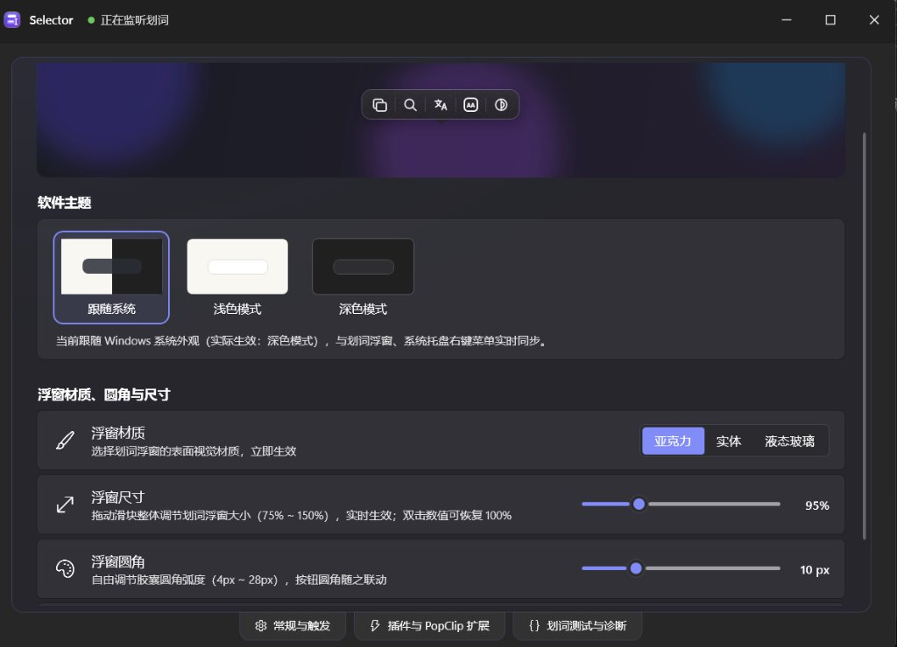

<div align="center">

# Selector

**轻盈、精致、可扩展的 Windows 划词浮动工具栏（PopClip for Windows）**

[](../../releases)
[-0078D4?style=flat-square)](#下载与使用)
[](#从源码构建)
[](#兼容-popclip-与插件扩展)
[](LICENSE)

[下载 v1.01 独立版](../../releases) · [核心特性](#核心特性) · [兼容 PopClip](#兼容-popclip-与插件扩展) · [从源码构建](#从源码构建)

<br />



</div>

---

## 简介

**Selector** 是一款面向 Windows 10 / 11 的智能划词浮动工具栏，交互灵感源自 macOS 上的 **PopClip**，界面与动效质感参考 **DropShelf** 设计语言，基于 **.NET 10 + WPF + Win32 / UI Automation** 原生构建。

在浏览器、编辑器或任意桌面应用中划选文字，浮窗会在选区附近**无焦点、不污染剪贴板**地优雅弹出，一键完成复制、搜索、翻译、格式转换、脚本执行或自定义 PopClip 扩展动作。

---

## 核心特性

### 1. 无干扰划词与只读选区捕获
- **零抢焦就近弹出**：基于 `WS_EX_NOACTIVATE` 与 `WM_MOUSEACTIVATE` 打造，弹出与点击动作不打断当前编辑器输入焦点。
- **仅选中、不自动复制**：默认采用只读 **UI Automation** 深度穿透捕获（支持 Edge / Chrome / Electron / WPF / 记事本等），划词绝不触发系统复制、不污染 `Ctrl+V` 与 `Win+V` 剪贴板历史；也提供可选的剪贴板兼容回退开关（全格式快照与无条件还原）。
- **多种触发与智能避让**：默认支持鼠标拖拽与双击/三击选词，可选 `Ctrl` / `Alt` 修饰键触发；自动识别密码框、独占全屏与自定义排除进程。

### 2. 精致界面、动效与高度可定制浮窗
- **全局三端同步主题**：支持 **浅色模式（暖瓷纸）**、**深色模式（克制炭灰）** 与 **跟随系统**，在设置窗口、划词浮窗与系统托盘右键菜单三端实时同步并响应 Windows 系统外观切换。
- **三款浮窗材质**：内置 **亚克力（Acrylic）**、**实体（Solid）** 与 **液态玻璃（Liquid Glass）**，配备所见即所得实时预览舞台。
- **精细外观控制**：
  - 滑块自由缩放浮窗整体大小（`75% ~ 150%`，双击数值快速恢复 `100%`）；
  - 自由调节浮窗圆角（`4px ~ 28px`）；
  - **图标 + 文字** / **纯图标** 双显示模式与统一对齐的 macOS 风格单色矢量图标库。
- **现代交互细节**：无边框 48px 标题栏、概览 2×2 响应式磁贴 ↔ 堆叠式设置页、底部页签直切、60fps 阻尼平滑滚轮，以及原生主题化 **WPF 系统托盘右键菜单**。

### 3. 兼容 PopClip 的可扩展插件生态
- **多形态动作引擎**：内置动作、URL 模板、文本变换、Shell / PowerShell 脚本、HTTP Webhook（支持 JSONPath 提取）以及 **PopClip JavaScript** 执行器。
- **划词一键安装 PopClip Snippet**：直接划选任意 `#popclip` YAML 或 `// #popclip` JS 片段，浮窗自动出现「一键安装」按钮。
- **直观的插件管理**：支持单行独立上移/下移、**按住提起拖拽快速排序**、独立启停开关、图标与徽章自定义（`symbol:*`、`square AA`、`circle W` 等）及插件配置项（Options）持久化。

---

## 下载与使用

1. 前往本仓库的 **[Releases](../../releases)** 页面，下载最新版 `Selector-v1.01-win-x64.zip`（内置 .NET 运行时，**无需额外安装环境**）。
2. 解压至任意目录，双击 **`Selector.exe`** 即可运行。
3. 在任意应用中拖选或双击文本即可体验划词浮窗；右键系统托盘图标可随时暂停/启用监听、切换主题或进入偏好设置。

> 用户配置与外置插件默认保存在 `%AppData%\Selector\`（`settings.json` 与 `plugins\`）。

---

## 兼容 PopClip 与插件扩展

### 方式一：划选或导入 PopClip Snippet（YAML）
在「插件与 PopClip 扩展」点击 **导入 PopClip Snippet**，或直接划选下方整段文本点击浮窗「一键安装」：

```yaml
#popclip
name: 豆瓣搜索
icon: circle 豆
url: https://www.douban.com/search?q=***
```

### 方式二：PopClip JavaScript 扩展（支持 `options`）
```javascript
// #popclip
// name: 添加标签前缀
// icon: square filled TAG
// after: paste-result
// options:
//   - identifier: prefix
//     label: 前缀文本
//     default value: "[NOTE] "
return (popclip.options.prefix || "") + popclip.input.text.trim();
```

### 方式三：放置外置 JSON 插件
将 `.json`、`.js` 或 `.popcliptxt` 放入 `%AppData%\Selector\plugins\`，点击设置页「重载 plugins/」即可热加载。参考仓库内 [plugins/](plugins/) 目录中的 5 个官方示例。

---

## 项目结构

```text
WinPopClip.sln
├── src/
│   ├── WinPopClip.Core/          # 领域模型、配置与持久化、PopClip 解析器、插件匹配与执行引擎
│   └── WinPopClip.App/           # WPF 界面（Selector）、浮窗与材质渲染、UIA 捕获、全局钩子、托盘 GUI
├── tests/
│   └── WinPopClip.Tests/         # 核心引擎、PopClip 解析/JS 执行、配置与迁移自动化测试
└── plugins/                      # 随包示例插件（JSON / PopClip JS / YAML Snippet）
```

---

## 从源码构建

环境要求：**Windows 10/11 (x64)** + **.NET 10 SDK**（如需运行 JS 插件需安装 Node.js）。

```powershell
# 1. 还原并构建整个解决方案
dotnet build WinPopClip.sln

# 2. 运行自动化单元测试
dotnet run --project tests/WinPopClip.Tests/WinPopClip.Tests.csproj

# 3. 开发模式运行 Selector
dotnet run --project src/WinPopClip.App/WinPopClip.App.csproj

# 4. 发布独立单文件 Selector.exe (v1.0, win-x64)
dotnet publish src/WinPopClip.App/WinPopClip.App.csproj -c Release -r win-x64 --self-contained true `
  -p:PublishSingleFile=true -p:IncludeNativeLibrariesForSelfExtract=true `
  -p:EnableCompressionInSingleFile=true -p:DebugType=None -p:DebugSymbols=false `
  -o dist/Selector-v1.0
```

---

## 开源协议

本项目基于 [MIT License](LICENSE) 开源。
